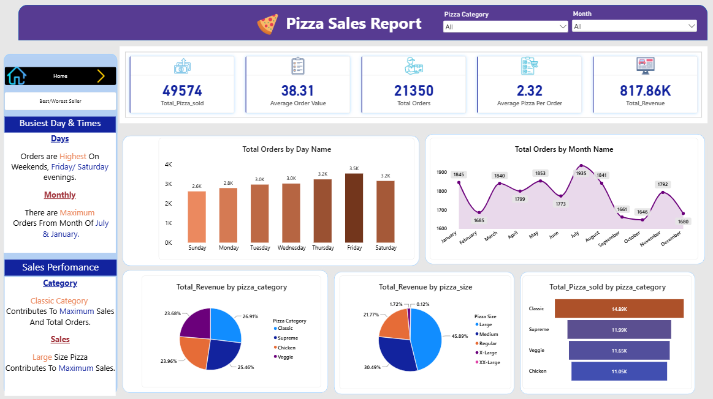
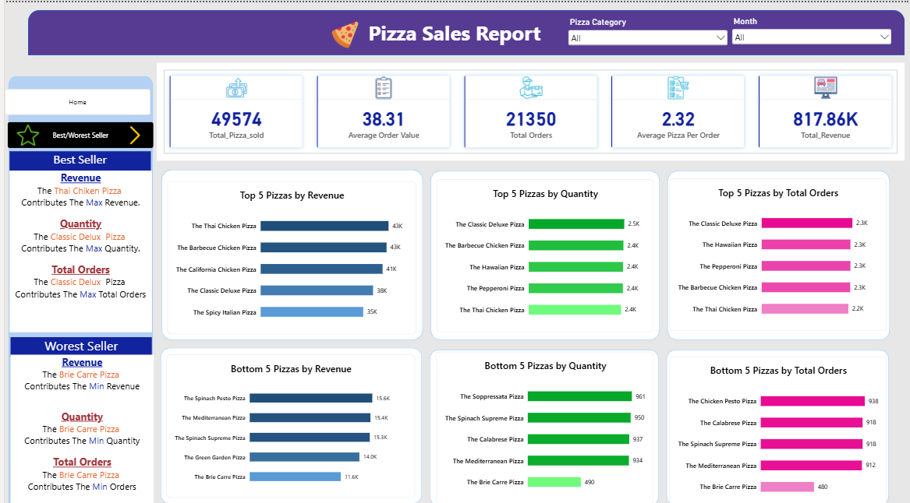

# 🍕 Pizza Sales Analytics Project (SQL Server + Power BI)

An end-to-end data analytics solution designed to analyze yearly pizza sales performance, identify key sales drivers, monitor peak purchasing patterns, and evaluate top/bottom-performing products for operational optimization.

---

## 📸 Dashboard Previews

### 1. Executive Summary (Home Page)


### 2. Best & Worst Sellers Analysis Page


---

## 📌 Project Overview & Objectives

The goal of this project is to process raw transactional data using **SQL Server** to execute business-critical queries and derive core KPIs. Subsequently, the data model is visualized in **Power BI** to deliver interactive dynamic reports for strategic business decision-making.

---

## 📁 Dataset Included

* **File Name:** `pizza_sales_excel_file.xlsx`[cite: 7]
* **Description:** Raw transactional dataset containing individual order records, pizza categories, sizes, prices, dates, and order times used for SQL querying and Power BI modeling.

---

## 📊 Key Business Metrics (KPIs Implemented)

- **Total Revenue:** $817.86K – Total money generated from sales across all pizza categories.
- **Average Order Value (AOV):** $38.31 – Average spend per customer order.
- **Total Pizzas Sold:** 49,574 units – Total volume of pizzas sold.
- **Total Orders:** 21,350 – Total number of distinct customer orders recorded.
- **Average Pizzas Per Order:** 2.32 – Average number of items contained in a single order.

---

## 🔍 Key Insights & Business Findings

1. **Peak Sales Days & Times:**
   - Orders peak during **Friday and Saturday evenings**, driven by weekend family/group purchases.
   - Monthly sales peak significantly during **July and January**.
2. **Category Performance:**
   - **Classic Category** contributes highest to total orders and maximum revenue share.
   - **Large Size Pizzas** drive the majority of sales volume compared to Regular, Medium, and XL sizes.
3. **Product Highlights (Best & Worst Performers):**
   - **Top Revenue Generator:** *The Thai Chicken Pizza* generates the highest overall sales revenue.
   - **Top Quantity Sold:** *The Classic Deluxe Pizza* leads in total unit volume and order count.
   - **Lowest Revenue/Volume:** *The Brie Carre Pizza* records the lowest overall orders and revenue generation.

---

## 🛠️ Technical Stack & Methods Used

### 1. Data Processing & Querying (SQL Server)
- Developed SQL scripts utilizing `SUM()`, `COUNT(DISTINCT)`, `AVG()`, `DATEPART()`, and `GROUP BY` logic.
- Executed queries for KPI calculations, sales trend breakdown by day/month, and customer purchasing behaviors.

```sql
-- Sample SQL Query: Total Revenue Calculation
SELECT SUM(total_price) AS Total_Revenue FROM pizza_sales;

-- Sample SQL Query: Daily Trend for Total Orders
SELECT DATENAME(DW, order_date) AS order_day, COUNT(DISTINCT order_id) AS total_orders 
FROM pizza_sales
GROUP BY DATENAME(DW, order_date);
